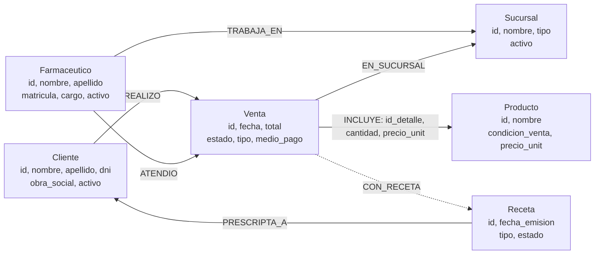

# Grafo Neo4j y consultas de la Parte A

Material para el informe de la Parte A del TPO FarmaRed. Los ejemplos se tomaron
el 2026-11-11 sobre una carga recién hecha desde los CSV de la cátedra, con
MongoDB 8.3.11 y Neo4j 5.26.32.

## 1. Por qué Neo4j

MongoDB resuelve bien los documentos y las escrituras: ventas con ítems
embebidos, recetas y clientes. Pero varias consultas del enunciado son
recorridos de relaciones:

- historial de un cliente: cliente → ventas y cliente → recetas;
- ventas pendientes: venta → farmacéutico → sucursal;
- clientes atendidos en una sucursal: cliente → venta ← farmacéutico →
  sucursal;
- productos de una venta: venta → producto.

En MongoDB esos recorridos se resuelven con `$lookup` o con varias consultas y
combinación en la aplicación. En Neo4j cada relación es una arista almacenada:
el motor sigue los punteros del grafo sin reconstruir la relación en cada
consulta. Por eso el grafo es una proyección de las entidades y relaciones que
se recorren, no una segunda fuente de verdad.

La proyección incluye solo los nodos y relaciones que necesitan q02, q03 y q10
(además de las relaciones venta–producto y venta–receta para mantener el modelo
completo). Proveedores, stock y detalle de lotes quedan en MongoDB.

## 2. Modelo del grafo

### Nodos y propiedades principales

| Nodo | Propiedades |
|---|---|
| `Cliente` | `id`, `nombre`, `apellido`, `dni`, `email`, `telefono`, `ciudad`, `provincia`, `obra_social`, `nro_afiliado`, `activo` |
| `Sucursal` | `id`, `nombre`, `tipo`, `direccion`, `ciudad`, `provincia`, `telefono`, `activo` |
| `Farmaceutico` | `id`, `nombre`, `apellido`, `matricula`, `cargo`, `activo` |
| `Producto` | `id`, `nombre`, `principio_activo`, `categoria`, `presentacion`, `condicion_venta`, `precio_unit`, `activo` |
| `Receta` | `id`, `medico`, `matricula_medico`, `fecha_emision`, `tipo`, `dispensas_autorizadas`, `dispensas_realizadas`, `proxima_dispensa`, `estado` |
| `Venta` | `id`, `fecha`, `tipo`, `medio_pago`, `total`, `estado`, `fecha_registro`, `id_sucursal` |

`id` es el identificador de la cátedra (`C001`, `V001`, `PRD001`, …). Hay un
constraint de unicidad sobre `id` para cada label, creado con
`CREATE CONSTRAINT ... IF NOT EXISTS`. Las fechas se guardan con el tipo `date`
de Neo4j, no como texto.

### Relaciones

| Relación | Origen → destino | Propiedades |
|---|---|---|
| `REALIZO` | `Cliente` → `Venta` | — |
| `ATENDIO` | `Farmaceutico` → `Venta` | — |
| `TRABAJA_EN` | `Farmaceutico` → `Sucursal` | — |
| `EN_SUCURSAL` | `Venta` → `Sucursal` | — |
| `INCLUYE` | `Venta` → `Producto` | `id_detalle`, `cantidad`, `precio_unit` |
| `CON_RECETA` | `Venta` → `Receta` | — |
| `PRESCRIPTA_A` | `Receta` → `Cliente` | — |

### Diagrama



`CON_RECETA` es opcional: solo existe en ventas con receta. Las ventas de tipo
`Venta libre` no tienen esa relación.

## 3. Consistencia entre MongoDB y Neo4j

MongoDB es la fuente de verdad. Neo4j se reconstruye desde Mongo y nunca recibe
escrituras que no hayan pasado primero por Mongo.

Actualización posterior a la auditoría: cada escritura de cliente, receta o venta incrementa `_version` y marca `grafo_pendiente` en MongoDB. El upsert bloquea el nodo antes de comparar versiones y descarta snapshots antiguos, incluyendo sus relaciones. La confirmación limpia el pendiente sólo si coincide la versión. Las lecturas se rechazan mientras haya cambios sin aplicar; la recuperación se realiza ejecutando `reconstruir()` explícitamente.

La carga usa un marcador `_estado_grafo` para impedir lecturas mientras está incompleta o falta reconstruir el grafo. Una carga interrumpida antes de terminar Mongo queda `carga_lista=False`: se debe repetir el cargador, y las lecturas no publican ese estado parcial. `scripts/cargar.py` devuelve código 1 si no pudo proyectar. La carga/reconstrucción se ejecuta como mantenimiento sin recargas concurrentes.

- **Carga completa.** `scripts/cargar.py` carga Mongo y después llama a
  `proyectar_todo()`. Esa función lee las colecciones, crea los constraints,
  vacía el grafo con `MATCH (n) DETACH DELETE n` y reconstruye todo en una
  transacción de escritura. El vaciado garantiza que el grafo refleje exactamente
  la carga actual y no conserve nodos de una carga anterior. La lectura previa de
  las colecciones no es una foto transaccional, así que la carga debe correr sin
  escrituras concurrentes en Mongo. Los constraints se crean antes de la
  transacción porque Neo4j no permite mezclar DDL y escrituras en la misma
  transacción.
- **Escrituras individuales.** q13 llama a `upsert_cliente`; q14 y q15 llaman a
  `upsert_venta_y_receta`, que escribe la venta y su receta en una sola
  transacción. Cada `upsert` borra las relaciones viejas del nodo antes de
  volver a crearlas, así que no duplica ni conserva vínculos obsoletos si cambia
  el cliente, el farmacéutico, la sucursal o la receta.
- **Fallo de Neo4j.** Si la proyección falla, la escritura en Mongo ya está
  confirmada. `proyectar()` captura el error y la consulta devuelve
  `aviso_grafo: "el grafo quedó pendiente"` sin propagar la excepción.
  Las lecturas quedan bloqueadas hasta ejecutar `reconstruir()`, que rehace todo el grafo desde Mongo.
- **Ítems repetidos.** `upsert_venta` conserva una relación `INCLUYE` por línea
  de detalle, identificada con `id_detalle`. Si una venta repite un producto con
  precios distintos, cada línea mantiene su propio `precio_unit`.
- **Sucursal histórica.** La carga agrega `id_sucursal` a cada venta a partir
  del farmacéutico y q14 lo fija al registrar la venta. Q15 conserva ese valor y rechaza completar una pendiente si el farmacéutico cambió de sucursal. q02 y
  q10 recorren `(Venta)-[:EN_SUCURSAL]->(Sucursal)`, por lo que una reasignación
  posterior del farmacéutico no mueve ventas históricas de sucursal.
- **Fechas.** `_fecha()` convierte los `datetime` de Mongo a `datetime.date`,
  que el driver envía como `date` de Neo4j.

Verificación de idempotencia: se corrió `scripts/cargar.py` dos veces. Las dos
dejaron 58 nodos y 96 relaciones:

| Nodo | Cantidad |
|---|---:|
| `Cliente` | 8 |
| `Farmaceutico` | 7 |
| `Producto` | 13 |
| `Receta` | 9 |
| `Sucursal` | 5 |
| `Venta` | 16 |

| Relación | Cantidad |
|---|---:|
| `ATENDIO` | 16 |
| `CON_RECETA` | 10 |
| `EN_SUCURSAL` | 16 |
| `INCLUYE` | 22 |
| `PRESCRIPTA_A` | 9 |
| `REALIZO` | 16 |
| `TRABAJA_EN` | 7 |

## 4. Consultas

### q02. Ventas pendientes con farmacéutico y sucursal

**Enunciado.** Ventas en estado `Pendiente` con el farmacéutico asignado
(nombre, matrícula y sucursal) y el total.

**Relación.** `Venta` se conecta con `Farmaceutico` por `ATENDIO` y con
`Sucursal` por `EN_SUCURSAL`. El recorrido es `Farmaceutico → Venta →
Sucursal`; la sucursal queda fijada al registrar la venta.

```cypher
MATCH (f:Farmaceutico)-[:ATENDIO]->(v:Venta {estado: 'Pendiente'})
MATCH (v)-[:EN_SUCURSAL]->(s:Sucursal)
RETURN v.id AS id_venta, v.fecha AS fecha, v.total AS total,
       f.id AS id_farmaceutico, f.nombre AS nombre_farmaceutico,
       f.apellido AS apellido_farmaceutico, f.matricula AS matricula,
       s.id AS id_sucursal, s.nombre AS nombre_sucursal
ORDER BY v.fecha, v.id
```

**Resultado real.**

| id_venta | fecha | total | farmacéutico | matrícula | sucursal |
|---|---|---:|---|---|---|
| `V012` | 2026-10-11 | 9200 | Natalia Giménez | MN-18289 | Farmacia Rosario Centro |
| `V011` | 2026-10-12 | 4800 | Matías Sandoval | MN-18340 | Farmacia Nueva Córdoba |

### q03. Historial de un cliente

**Enunciado.** Historial completo de un cliente: ventas y recetas ordenadas
cronológicamente por fecha.

**Relación.** Las ventas se recorren por `(Cliente)-[:REALIZO]->(Venta)` y las
recetas por `(Receta)-[:PRESCRIPTA_A]->(Cliente)`. La consulta arma una línea de
tiempo con `UNION ALL`: las ventas usan `fecha` y las recetas `fecha_emision`.
El resultado se ordena por fecha, tipo de evento e id.

```cypher
MATCH (c:Cliente {id: $id_cliente})
CALL (c) {
    MATCH (c)-[:REALIZO]->(v:Venta)
    RETURN 'venta' AS tipo_evento, v.id AS id, v.fecha AS fecha,
           v.estado AS estado, v.total AS total, v.tipo AS detalle
    UNION ALL
    MATCH (c)<-[:PRESCRIPTA_A]-(r:Receta)
    RETURN 'receta' AS tipo_evento, r.id AS id, r.fecha_emision AS fecha,
           r.estado AS estado, null AS total, r.tipo AS detalle
}
RETURN tipo_evento, id, fecha, estado, total, detalle
ORDER BY fecha, tipo_evento, id
```

Si el cliente no existe o no tiene ventas ni recetas, devuelve `[]`.

**Resultado real para `C006`.**

| tipo_evento | id | fecha | estado | total | detalle |
|---|---|---|---:|---:|---|
| receta | `RC003` | 2026-08-01 | Vigente | — | Tratamiento prolongado |
| venta | `V006` | 2026-08-01 | Completada | 22100 | Con receta |
| venta | `V007` | 2026-09-01 | Completada | 22100 | Con receta |
| receta | `RC004` | 2026-09-20 | Vigente | — | Tratamiento prolongado |
| venta | `V008` | 2026-09-20 | Completada | 8900 | Con receta |
| venta | `V016` | 2026-10-07 | Completada | 7800 | Venta libre |

`C008` y `C999` devuelven `[]`.

### q10. Clientes atendidos en una sucursal

**Enunciado.** Todos los clientes atendidos en una sucursal determinada, a
través del farmacéutico que registró la venta, esté activo o no.

**Relación.** El recorrido es
`(Cliente)-[:REALIZO]->(Venta)-[:EN_SUCURSAL]->(Sucursal)` y
`(Venta)<-[:ATENDIO]-(Farmaceutico)`. No se filtra `f.activo`: la consulta
incluye farmacéuticos inactivos. `DISTINCT` evita repetir un cliente que compró
varias veces en la sucursal.

```cypher
MATCH (c:Cliente)-[:REALIZO]->(v:Venta)-[:EN_SUCURSAL]->(s:Sucursal {id: $id_sucursal})
MATCH (f:Farmaceutico)-[:ATENDIO]->(v)
RETURN DISTINCT c.id AS id_cliente, c.nombre AS nombre,
       c.apellido AS apellido, c.dni AS dni, c.activo AS activo
ORDER BY c.apellido, c.nombre
```

**Resultado real para `S002`.**

| id_cliente | nombre | apellido | dni | activo |
|---|---|---|---|---|
| `C001` | Lucía | Fernández | 31245678 | True |
| `C004` | Federico | Navarro | 33987654 | True |

`C004` aparece por la venta `V001`, registrada por `F004`, que está inactivo.
Para `S005` (Droguería Central) devuelve `[]`, porque `F007` no tiene ventas.
